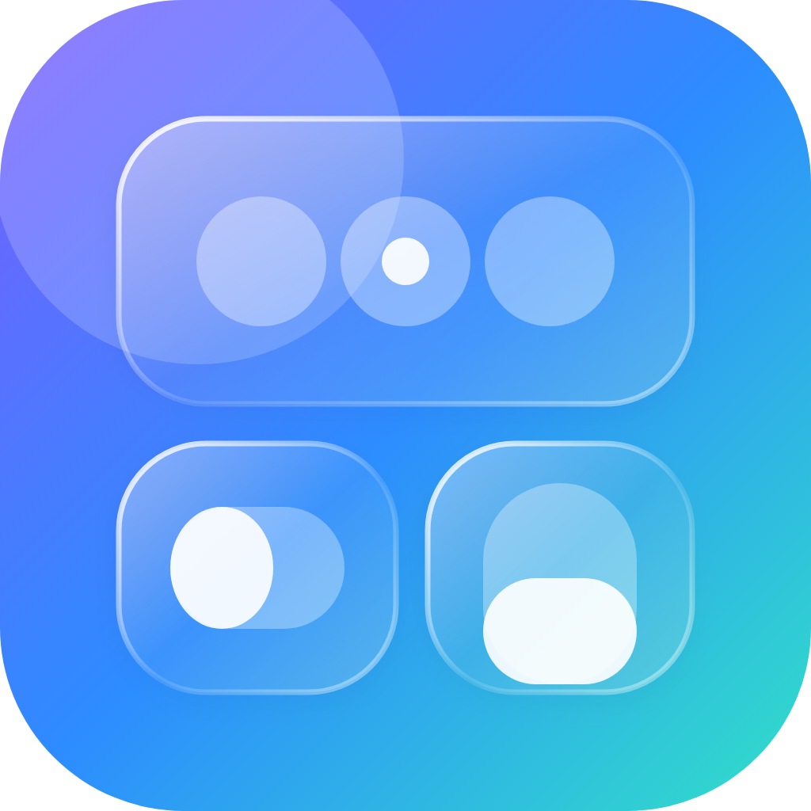

<p align="center"></p>

<h1 align="center">Control Center 26</h1>

<p align="center">An iOS 26 style <b>liquid glass</b> Control Center for iOS 14 to 16 (made for the iPhone 7 Plus).</p>

## What changes

- **Rounder tiles.** 30 pt continuous corners, like iOS 26, instead of the old 19 pt.
- **Liquid glass edge.** A thin rim that is bright where light hits (top left) and fades away, plus a soft sheen across each tile.
- **Capsule sliders.** Brightness and volume become full capsules.
- **Glass buttons.** The round buttons get the same rim and sheen.
- **Soft depth tint** behind the tiles.

## Fast on purpose

It re-uses the system's own blur instead of adding new blur views, adds only two cheap gradient layers per tile, rebuilds them only when a size changes, and has no timers, observers or animations. On an A10 chip the cost is close to zero.

## Honest notes

- This is a close **look-alike**, not a pixel copy. iOS 14 to 16 draws Control Center with different parts than iOS 26, so some details (like the live lensing of real Liquid Glass) are not possible.
- It uses private Control Center classes (`CCUIContentModuleContainerView`, `CCUIRoundButton`, `CCUIContinuousSliderView`). If a future iOS renames one, that part simply does nothing and nothing crashes.

## Install

Download from **Releases**: `iphoneos-arm` (rootful: checkra1n, unc0ver, Odyssey) or `iphoneos-arm64` (rootless: Dopamine, palera1n). Install with Sileo, Zebra or Filza and respring.

## Build

```sh
make package FINALPACKAGE=1                                # rootful
make package FINALPACKAGE=1 THEOS_PACKAGE_SCHEME=rootless  # rootless
```
